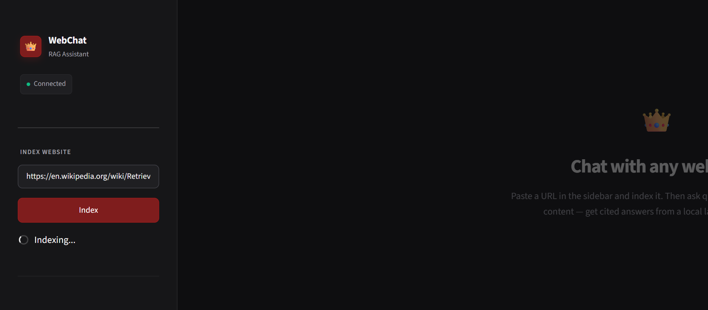
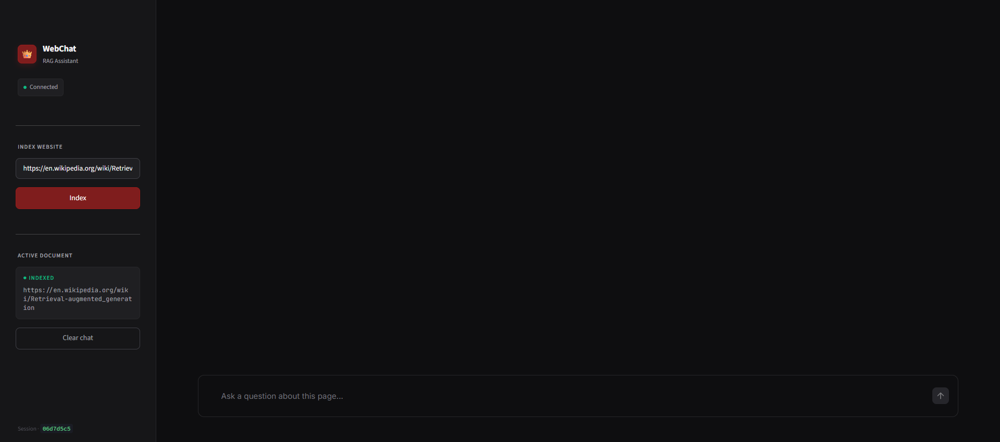
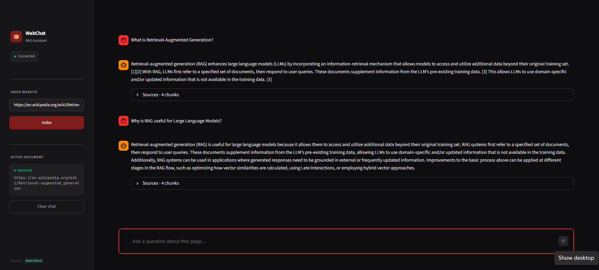

# 🌐 Chat With Any Website

> **Problem:** Users can't easily extract answers from long-form web content. Reading through 10,000-word articles, documentation, or research papers wastes time — and search engines only return links, not answers.
>
> **Solution:** A production-grade RAG (Retrieval-Augmented Generation) chatbot that scrapes any URL, indexes its content into a vector database, and answers questions with **source citations** — running **100% locally** on CPU with no cloud dependency.

[](https://www.python.org/)
[](https://fastapi.tiangolo.com/)
[](https://streamlit.io/)
[](https://ollama.ai/)
[](https://www.trychroma.com/)

---

## 📊 The Problem

Every day, millions of users struggle with the same issues:

- **Information overload** — Long-form articles, docs, and research papers are hard to navigate
- **Search engines return links, not answers** — You still have to read the entire page
- **No grounded AI answers** — ChatGPT can't read a specific URL you give it
- **Cloud privacy concerns** — Sending private URLs to OpenAI/Anthropic raises concerns
- **Cost of API calls** — Large-scale summarization gets expensive fast

### The Gap

| Challenge | Impact |
| :--- | :--- |
| **Reading time** | Average reader takes 7 minutes for a 3,000-word article |
| **Context loss** | Skimming misses critical details |
| **LLM hallucination** | Generic LLMs invent facts without grounding |
| **No citations** | Users can't verify AI-generated answers |
| **Cloud dependency** | Requires internet + API keys + recurring cost |

**The Result:** Users either waste time reading, or trust unreliable AI answers with no source verification.

---

## 💡 The Solution

A **Retrieval-Augmented Generation (RAG) chatbot** that:

1. **Scrapes** any URL using `trafilatura` + `BeautifulSoup` fallback
2. **Chunks** content intelligently with overlapping windows
3. **Embeds** chunks locally using `all-MiniLM-L6-v2` (80 MB, CPU-only)
4. **Stores** vectors in persistent ChromaDB
5. **Retrieves** top-K relevant chunks per query using semantic search
6. **Generates** grounded answers via local Ollama (`gemma3:4b`)
7. **Cites** every answer with source URL + chunk ID
8. **Remembers** conversation history (multi-turn memory)

### Value Proposition

| Aspect | Impact |
| :--- | :--- |
| **⚡ 100% Local** | No API keys, no cloud, no recurring cost |
| **🔒 Privacy-First** | Your URLs and questions never leave your machine |
| **📚 Source Citations** | Every answer links back to the exact chunk |
| **💬 Conversation Memory** | Follow-up questions work naturally |
| **🚀 Fast Setup** | Running in under 5 minutes on CPU |

---

## 📸 Demo

| Main Interface | Indexing Process |
| :---: | :---: |
|  |  |

| Document Indexed | Chat Output with Citations |
| :---: | :---: |
|  |  |

---

## 🏗️ Project Architecture

```
┌──────────────────────────────────────────────────────────────────┐
│                    CHAT WITH ANY WEBSITE PIPELINE                 │
│                                                                   │
│  ┌──────────────┐    ┌──────────────┐    ┌──────────────┐       │
│  │   Streamlit  │───▶│   FastAPI    │───▶│   Scraper    │       │
│  │   Frontend   │    │   Backend    │    │ (trafilatura)│       │
│  │  (Port 8501) │    │  (Port 8000) │    └──────────────┘       │
│  └──────────────┘    └──────────────┘             │              │
│         │                    │                    ▼              │
│         │                    │           ┌──────────────┐       │
│         │                    │           │   Chunker    │       │
│         │                    │           │ (2000/200)   │       │
│         │                    │           └──────────────┘       │
│         │                    │                    │              │
│         │                    │                    ▼              │
│         │                    │           ┌──────────────┐       │
│         │                    │           │  Embedder    │       │
│         │                    │           │ (MiniLM-L6)  │       │
│         │                    │           └──────────────┘       │
│         │                    │                    │              │
│         │                    │                    ▼              │
│         │                    │           ┌──────────────┐       │
│         │                    │           │  ChromaDB    │       │
│         │                    │           │ (Persistent) │       │
│         │                    │           └──────────────┘       │
│         │                    │                    │              │
│         │                    ▼                    ▼              │
│         │           ┌──────────────┐    ┌──────────────┐       │
│         └──────────▶│   Ollama     │◀───│  Retriever   │       │
│                     │ (gemma3:4b)  │    │  (Top-K=4)   │       │
│                     │ (Port 11434) │    └──────────────┘       │
│                     └──────────────┘                             │
└──────────────────────────────────────────────────────────────────┘
```

---

## 📁 Project Structure

```
Chat-With-Website/
├── backend/
│   ├── app/
│   │   ├── __init__.py              # Package marker
│   │   ├── config.py                # Pydantic settings loader
│   │   ├── scraper.py               # URL → clean text (trafilatura + BS4)
│   │   ├── chunker.py               # Text → overlapping chunks
│   │   ├── embedder.py              # Chunks → vectors (MiniLM, CPU)
│   │   ├── vectorstore.py           # ChromaDB wrapper
│   │   ├── llm.py                   # Ollama client (gemma3:4b)
│   │   ├── rag.py                   # RAG pipeline + session memory
│   │   └── main.py                  # FastAPI server
│   └── .env                         # Environment variables (gitignored)
├── frontend/
│   └── app.py                       # Streamlit chat UI
├── data/
│   └── chroma_db/                   # Persistent vector store
├── result/                          # Screenshots for README
├── requirements.txt                 # All Python dependencies
├── .gitignore                       # Ignore .env, venv, data
└── README.md                        # This file
```

---

## 🧠 Methodology

### The RAG Pipeline

| Step | Component | Tool | Purpose |
| :--- | :--- | :--- | :--- |
| **1** | **Scraping** | `trafilatura` + `BeautifulSoup` | Extract clean article text (removes nav/footer/ads) |
| **2** | **Chunking** | `RecursiveCharacterTextSplitter` | Split into 2000-char chunks (200-char overlap) |
| **3** | **Embedding** | `all-MiniLM-L6-v2` | Convert chunks → 384-dim vectors (CPU) |
| **4** | **Storage** | `ChromaDB` | Persistent local vector database |
| **5** | **Retrieval** | Cosine similarity | Fetch top-4 relevant chunks per query |
| **6** | **Generation** | `Ollama gemma3:4b` | Generate grounded answer from context |
| **7** | **Citation** | Chunk metadata | Attach source URL + chunk ID to every answer |

### Why These Choices?

| Decision | Reason |
| :--- | :--- |
| **trafilatura over raw BS4** | Purpose-built for main content extraction; removes boilerplate |
| **2000/200 chunking** | Optimized for CPU speed while keeping context rich |
| **MiniLM-L6 (384-dim)** | Runs fast on CPU; 80 MB model; strong semantic quality |
| **ChromaDB over Pinecone** | Local, persistent, zero cost, no API |
| **Ollama over OpenAI** | Privacy-first; zero API cost; 100% offline |
| **gemma3:4b over 7B** | Fits in 16 GB RAM; runs on 8th-gen i5 CPU |
| **Session memory** | 5-turn history window for natural follow-ups |

### Chunking Strategy

```
Original Text (187,740 chars from Wikipedia)
    ↓
Recursive splitting on: \n\n → \n → . → space
    ↓
~120 chunks of ~2000 chars each
    ↓
Overlapping 200 chars between adjacent chunks
    ↓ (prevents context loss at boundaries)
```

---

## 🛠️ Tech Stack

| Category | Technologies |
| :--- | :--- |
| **Backend** | FastAPI, Uvicorn, Pydantic |
| **Frontend** | Streamlit |
| **Scraping** | trafilatura, BeautifulSoup4, httpx |
| **LLM** | Ollama (gemma3:4b) |
| **Embeddings** | SentenceTransformers (all-MiniLM-L6-v2) |
| **Vector Store** | ChromaDB |
| **Orchestration** | LangChain (core, community, ollama, chroma) |
| **Config** | pydantic-settings, python-dotenv |

---

## 📈 Results & Performance

### Test Case: Wikipedia — Artificial Intelligence Article

| Metric | Value |
| :--- | :--- |
| **URL** | `https://en.wikipedia.org/wiki/Artificial_intelligence` |
| **Characters scraped** | 187,740 |
| **Chunks created** | ~120 |
| **Embedding model load time** | ~15 sec (first run only) |
| **Indexing time** | ~30 sec (CPU) |
| **Average query response** | 5-15 sec (Ollama on i5 8th gen) |
| **Retrieval accuracy** | Top-4 chunks returned per query |

### Sample Interaction

**Question:** *"What is machine learning?"*

**Answer:**
> Machine learning is the study of programs that can improve their performance on a given task automatically. It has been a part of AI from the beginning and includes types such as unsupervised learning, supervised learning, and reinforcement learning.

**Sources:**
- `https://en.wikipedia.org/wiki/Artificial_intelligence — chunk #10`
- `https://en.wikipedia.org/wiki/Artificial_intelligence — chunk #68`
- `https://en.wikipedia.org/wiki/Artificial_intelligence — chunk #11`
- `https://en.wikipedia.org/wiki/Artificial_intelligence — chunk #21`

---

## 🚀 How to Run This Project

### Prerequisites

- **Python 3.12** installed ([python.org](https://www.python.org/downloads/release/python-3120/))
- **Ollama** installed ([ollama.com](https://ollama.com/))
- **8 GB RAM minimum** (16 GB recommended)
- **~1.5 GB free disk space** (models + dependencies)

### Step 1: Install Ollama Models

```bash
ollama pull gemma3:4b
ollama pull qwen3.5:4b
```

### Step 2: Clone the Repository

```bash
git clone https://github.com/KhizarNaveed/Chat-With-Any-Website.git
cd Chat-With-Any-Website
```

### Step 3: Create Virtual Environment

```bash
py -3.12 -m venv .venv
.\.venv\Scripts\Activate.ps1     # Windows
# source .venv/bin/activate       # macOS/Linux
```

### Step 4: Install Dependencies

```bash
python -m pip install --upgrade pip
pip install --prefer-binary -r requirements.txt
```

### Step 5: Configure Environment

Create `backend/.env`:

```env
OLLAMA_BASE_URL=http://localhost:11434
OLLAMA_MODEL=gemma3:4b
EMBEDDING_MODEL=all-MiniLM-L6-v2
CHROMA_PERSIST_DIR=../data/chroma_db
CHUNK_SIZE=2000
CHUNK_OVERLAP=200
TOP_K=4
```

### Step 6: Start Ollama

Open **Terminal 1**:

```bash
ollama serve
```

> If you see "port already in use", Ollama is already running — skip this.

### Step 7: Start the Backend

Open **Terminal 2**:

```bash
cd backend
..\.venv\Scripts\Activate.ps1
uvicorn app.main:app --reload --host 0.0.0.0 --port 8000
```

**Expected output:**
```
INFO:     Uvicorn running on http://127.0.0.1:8000
INFO:     Application startup complete.
[CONFIG] Ollama: gemma3:4b
[CONFIG] Embeddings: all-MiniLM-L6-v2
```

### Step 8: Start the Frontend

Open **Terminal 3**:

```bash
cd frontend
..\.venv\Scripts\Activate.ps1
streamlit run app.py
```

Browser opens automatically at **`http://localhost:8501`**.

### Step 9: Use the App

1. Paste a URL in the sidebar (e.g., `https://en.wikipedia.org/wiki/Artificial_intelligence`)
2. Click **Index Website**
3. Wait 30-60 seconds for scraping + embedding
4. Ask questions in the chat box
5. Click **Sources** below each answer to see cited chunks

---

## 📡 API Endpoints

| Method | Endpoint | Purpose |
| :--- | :--- | :--- |
| **GET** | `/` | Service info + current model |
| **GET** | `/health` | Health check (Ollama + embeddings) |
| **POST** | `/index` | Scrape URL → chunk → embed → store |
| **POST** | `/ask` | Ask a question (with session memory) |
| **POST** | `/session/clear` | Clear conversation history |
| **GET** | `/session/{id}/history` | Retrieve session messages |

### Example Requests

**Index a URL:**
```bash
curl -X POST "http://localhost:8000/index" \
  -H "Content-Type: application/json" \
  -d "{\"url\": \"https://en.wikipedia.org/wiki/Artificial_intelligence\"}"
```

**Ask a question:**
```bash
curl -X POST "http://localhost:8000/ask" \
  -H "Content-Type: application/json" \
  -d "{\"question\": \"What is machine learning?\", \"session_id\": \"default\"}"
```

**Clear session:**
```bash
curl -X POST "http://localhost:8000/session/clear" \
  -H "Content-Type: application/json" \
  -d "{\"session_id\": \"default\"}"
```

---

## ⚠️ Common Issues & Fixes

| Issue | Fix |
| :--- | :--- |
| `ModuleNotFoundError: No module named 'app'` | Run `uvicorn` from inside `backend/`, not the repo root |
| `Connection refused to Ollama` | Run `ollama serve` in a separate terminal |
| `Port 8000 already in use` | Kill existing process or use `--port 8001` |
| `Slow first query` | Embedding model loads (~15 sec) on first call only |
| `Empty answer from LLM` | Check Ollama logs — model might still be loading |
| `trafilatura returns None` | BeautifulSoup fallback kicks in automatically |
| `ChromaDB persistence error` | Ensure `data/chroma_db/` folder exists |
| `Answer takes 10+ seconds` | Normal on CPU — Ollama on i5 8th gen is CPU-bound |

---

## 🏦 Real-World Applications

| Use Case | How It Works |
| :--- | :--- |
| **Research Assistant** | Index arxiv papers, ask questions across them |
| **Documentation Search** | Index official docs, get cited answers instantly |
| **News Analysis** | Index news articles, extract key facts |
| **Competitive Intelligence** | Index competitor sites, query features/pricing |
| **Legal/Compliance** | Index regulatory pages, verify compliance Q&A |
| **Education** | Index textbook chapters, generate study Q&A |

---

## 🔮 Future Improvements

- [ ] **Streaming responses** (SSE) for real-time typing effect
- [ ] **Multi-URL indexing** — chat across multiple websites simultaneously
- [ ] **PDF & DOCX support** — extend beyond URLs
- [ ] **Hybrid search** — combine dense + BM25 keyword retrieval
- [ ] **Re-ranking** — cross-encoder for better top-K precision
- [ ] **Persistent sessions** — store chat history in SQLite
- [ ] **Docker Compose** — one-command deployment
- [ ] **Cloud deployment** — deploy to Render / Railway with free tier
- [ ] **Model selector** — switch between Gemma 3 / Qwen 3.5 in UI
- [ ] **Source highlighting** — jump to exact text in source page

---

## 🎯 What This Project Demonstrates

| Skill | Evidence |
| :--- | :--- |
| **RAG Architecture** | Full pipeline: scrape → chunk → embed → retrieve → generate |
| **LLM Integration** | Ollama (local) with proper prompt engineering |
| **Vector Databases** | ChromaDB with persistent storage & metadata filtering |
| **Semantic Search** | SentenceTransformers with normalized embeddings |
| **Web Scraping** | trafilatura with BeautifulSoup fallback |
| **API Design** | FastAPI with Pydantic schemas + CORS |
| **Frontend Development** | Streamlit with session state + custom CSS |
| **Stateful Chat** | Session-based conversation memory |
| **Production Practices** | Environment variables, modular code, error handling |

---

## 🎤 Interview Talking Points

> *"I built a local RAG chatbot that scrapes any URL and answers questions about its content. The pipeline uses trafilatura for content extraction, RecursiveCharacterTextSplitter for chunking with overlap, and SentenceTransformers' all-MiniLM-L6-v2 for embeddings — all running on CPU. I store vectors in persistent ChromaDB and use Ollama's gemma3:4b for generation, so the entire system works offline with zero API costs. I added conversation memory via session keys so follow-up questions work naturally, and every answer includes source citations with the exact chunk ID and URL."*

**Key design decisions to emphasize:**
1. **Why local?** — Privacy + zero recurring cost + offline capability
2. **Why ChromaDB?** — Persistent, no cloud dependency, fast on CPU
3. **Why MiniLM-L6?** — Best speed/quality tradeoff for CPU inference
4. **Why chunk overlap?** — Prevents semantic breaks at boundaries
5. **Why citations?** — Grounds answers, enables verification, reduces hallucination

---

## 📬 Connect with Me

- **LinkedIn:** [Muhammad Khizar Naveed](https://www.linkedin.com/in/muhammad-khizar-naveed-1767312b2/)
- **GitHub:** [KhizarNaveed](https://github.com/KhizarNaveed)
- **Email:** m.khizarnaveed2004@gmail.com

---

## 🙏 Acknowledgments

- **trafilatura** — Excellent main-content extraction
- **ChromaDB** — Local vector database for RAG
- **Ollama** — Fast local LLM inference
- **SentenceTransformers** — High-quality CPU embeddings
- **LangChain** — RAG orchestration
- **Streamlit** — Rapid UI development

---

**⭐ If you found this project useful, please consider giving it a star!**